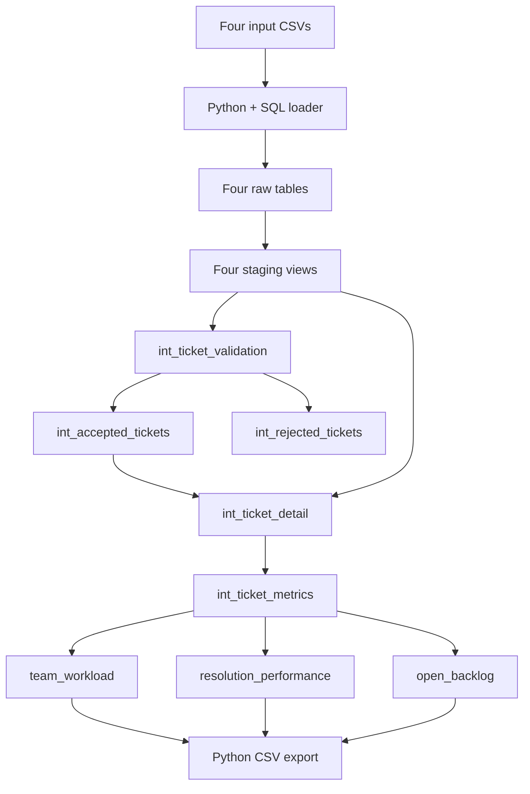

# Customer support reporting

A local analytics project using Python, DuckDB, SQL, and dbt to turn support ticket data into reports on team workload, resolution commitment performance, and the open backlog. Invalid records are retained separately with rejection reasons, making the cleaning process traceable.

## Data

The dataset is entirely synthetic and represents tickets created from January through March 2026, with a reporting snapshot at **April 1, 2026, 00:00:00 UTC**.

| Input | Rows | Contents |
| --- | ---: | --- |
| `tickets.csv` | 2,010 | Ticket IDs, customer and agent IDs, priorities, and creation/resolution timestamps |
| `customers.csv` | 120 | Customer names and service tiers: Standard, Plus, and Premium |
| `agents.csv` | 12 | Agent names and teams: Account, Billing, and Technical |
| `service_commitments.csv` | 12 | Resolution targets for each service tier and priority pair |

The ticket file deliberately includes ten exact duplicate copies and twenty invalid records covering missing customers, unknown agents, invalid priorities, and resolution before creation. After cleaning, 1,980 tickets remain for reporting. Blank agent and resolution fields are valid: they represent unassigned and unresolved tickets.

## How it works

| Tool | Role in the project |
| --- | --- |
| Python | Runs the raw-data loader and report exporter, with paths anchored to the project directory |
| SQL | Loads CSVs, validates records, joins lookups, calculates elapsed durations, and aggregates reports |
| DuckDB | Stores the local raw tables, transformation views, and final report tables |
| dbt | Manages SQL model dependencies, builds the transformations, runs data tests, and generates model documentation |
| pandas | Converts query results into CSV exports without an extra index column |



Staging gives the raw columns explicit types. Validation removes exact duplicate rows and separates accepted tickets from rejected records. Accepted tickets are enriched with customer, agent, team, and commitment information before calculating status, resolution time, open age, and commitment classification.

Staging and intermediate models are views; the final reporting models are tables. dbt uses `source()` for raw inputs and `ref()` for model dependencies. Data tests check lookup keys, validation outputs, durations, classifications, and report reconciliation.

## Business rules

- Timestamps are interpreted as UTC. Open age is measured at the fixed snapshot, so rerunning the project does not change the reporting date.
- Durations use elapsed seconds divided by 3,600. The clock runs continuously through nights and weekends, with no paused time or reopening history.
- Tickets with missing or unknown customers, unknown non-null agents, invalid priorities, or resolution before creation are rejected. Valid priorities are Low, Medium, High, and Urgent.
- Exact duplicate copies are removed across all six ticket fields. Conflicting versions are preserved and fail ticket-ID uniqueness tests.
- A null agent ID belongs to the `Unassigned` group. A null resolution timestamp means `Unresolved`; otherwise the ticket is `Resolved`.
- Resolution targets join on **both service tier and priority**. Resolved duration at or below its target is within commitment. Open age becomes overdue only when it exceeds its target; equality remains within the deadline.
- `commitment_achievement_pct` is `100 * resolved within commitment / resolved tickets`. Open tickets are excluded from the denominator. Teams with no resolved tickets have null average resolution time and null achievement percentage.
- Classification uses full duration precision; averages and percentages are rounded for reporting.

## Reports

The final marts are exported to `support_reporting/outputs/`. The small CSVs included in the project are reproducible examples.

| Mart / CSV | One row represents | Main measures and purpose |
| --- | --- | --- |
| `team_workload` / `team_workload.csv` | One team, including Unassigned; key: `team` | Total, resolved, open, within-commitment, and overdue counts; average resolution hours; commitment achievement percentage. Describes workload and resolved outcomes. |
| `resolution_performance` / `resolution_performance.csv` | One service tier and priority pair with resolved tickets; key: `service_tier` + `priority` | Resolved, within-commitment, and late counts; average resolution hours; commitment achievement percentage. Shows outcomes against each group's resolution target. |
| `open_backlog` / `open_backlog.csv` | One unresolved accepted ticket; key: `ticket_id` | Customer, tier, agent, team, priority, creation timestamp, open age, target hours, and commitment status. Lists outstanding work, sorted overdue first, then age descending and ticket ID. |

## Dataset findings

- **936 of 1,660 resolved tickets met their commitment (56.39%).** This overall rate uses total resolved counts rather than an average of group percentages.
- **312 of 320 open tickets were overdue (97.5%)** at the snapshot. The backlog included 80 unassigned tickets, of which 78 were overdue.
- **Technical had the largest recorded workload**, with 973 of 1,980 accepted tickets. Its resolved-ticket achievement was 48.33%, compared with 65.95% for Billing and 61.65% for Account. These descriptive differences do not establish a fair productivity ranking because ticket mix differs across teams.

The resulting marts contain four team rows, twelve tier/priority rows, and 320 backlog rows. These findings describe the supplied synthetic snapshot.

## Project structure

```text
requirements.txt
support_reporting/                 dbt project directory
  dbt_project.yml
  profiles.example.yml             Portable connection template
  project_paths.py                 Shared database and output paths
  load_raw.py / load_data.sql       Raw-data loading
  data_checks.sql                  Raw-load row counts
  export_reports.py                CSV export
  data/                            Four synthetic input CSVs
  models/
    staging/
    intermediate/
    reporting/
  tests/                           SQL data tests
  outputs/                         Three report CSVs
```

## Reproduce locally

Use **Python 3.13.9 (64 bit)** and Git on Windows. The runtime dependencies are pinned in `requirements.txt`.

From the repository root, run these PowerShell commands:

```powershell
python -m venv .venv
.\.venv\Scripts\Activate.ps1
python -m pip install -r requirements.txt

Set-Location .\support_reporting
if (-not (Test-Path .\profiles.yml)) {
    Copy-Item .\profiles.example.yml .\profiles.yml
}
dbt debug --profiles-dir .
python .\load_raw.py
dbt build --profiles-dir .
python .\export_reports.py
```

Run each step after the previous one succeeds. `dbt build` builds the models and runs their tests; export the reports after it passes. The profile template is copied only when a local profile does not already exist.

The default database is `support_reporting/support_reporting.duckdb`, and reports are saved in `support_reporting/outputs/`. Run dbt from the `support_reporting/` directory. Repeating the load/build/export steps replaces the tables and CSVs rather than appending data.

Optional absolute paths can be supplied through `SUPPORT_DUCKDB_PATH` (shared by Python and dbt) and `SUPPORT_OUTPUT_DIR` (CSV destination). Generate model documentation with `dbt docs generate --profiles-dir .`.
